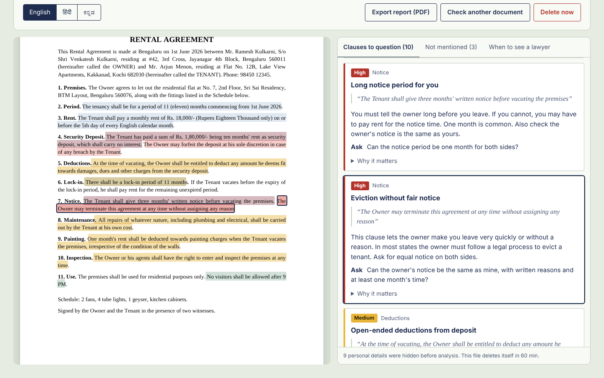
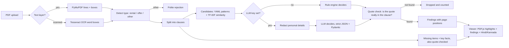

# TermGuard

**Upload a rental agreement or a job offer letter. TermGuard highlights the clauses worth questioning, explains each one in plain words, and shows the exact line it comes from.**

Students and first-time employees sign documents they don't fully understand: deposits the owner can keep for any reason, 11-month lock-ins, training bonds, 90-day notice periods, CTCs that are half "variable". TermGuard reads the PDF (scanned copies too), checks every clause against a written checklist, and refuses to show any point it cannot quote from your document.



> TermGuard gives information, not legal advice. Tenancy and employment rules differ by state in India.

## What it does

- **Reads any PDF.** Text PDFs through PyMuPDF with line positions; scanned pages through Tesseract OCR with word boxes.
- **Splits clauses** using numbering (`1.`, `2.1`, `(a)`, `Clause 5`) and ALL-CAPS headings, falling back to paragraphs (or an LLM, if configured) for unnumbered letters.
- **Checks 24 red flags** from a YAML checklist you can read and edit: 12 for rental agreements, 12 for offer letters, each with a risk level, a plain-English explanation and a question to ask.
- **Lists what is missing**, such as no deposit-return deadline or no salary breakup (13 expected items).
- **Key facts card**: rent, deposit, lock-in, notice; or CTC, fixed, variable, bond, notice. Values are shown exactly as written, never calculated.
- **Highlighted PDF viewer**: risk-coloured highlights; click a finding to jump to its line, or a highlight to jump to its finding.
- **Hindi and Kannada** explanations (the quote always stays in the original language).
- **Private by default**: names, phones, emails, Aadhaar, PAN, account numbers and addresses are replaced with placeholders before any text reaches an LLM; files delete themselves after 60 minutes; a "Delete now" button; document text is never logged.
- **Export** the analysis as a PDF report.

## The quote check (why nothing is made up)

Every finding must carry a verbatim quote. After the engine (rules or LLM) answers, `backend/app/verify.py` searches for that quote in the real clause text, ignoring only spacing, case and curly quotes. If the words are not on the page, the finding is dropped before the user sees it. A model can invent a convincing clause; it cannot invent one that survives a string search of your own document. The test suite feeds the analyzer a fake quote and checks it is rejected.

## Results

Rule engine, offline, on the 11 synthetic sample documents (88 clauses, labelled clause by clause):

| Metric | Value |
|---|---|
| Precision | **98%** (47 of 48 findings correct) |
| Recall | **89%** (47 of 53 labelled risks found) |
| Findings shown without a verified quote | **0** |
| Reading ease of explanations (Flesch) | 83.4 (easy) |

Full per-item table and every failure case: [`eval/results.md`](eval/results.md). The rules were written alongside these samples, so treat these numbers as optimistic. To measure on real documents, put redacted PDFs in `samples/private/`, label them with `python eval/label_tool.py samples/private/<file>.pdf`, and run `python eval/run_eval.py`.

## How it works



| Part | Tool |
|---|---|
| PDF text and positions | PyMuPDF |
| Scanned PDFs | Tesseract OCR (optional) |
| Knowledge base | YAML checklists in `backend/knowledge/` |
| Matching | TF-IDF cosine (pure Python); sentence-transformers optional |
| Analysis | Rule engine offline, or any OpenAI-compatible LLM (OpenRouter free models) |
| Backend | FastAPI, SQLite, Pydantic |
| Frontend | React 19, Vite, PDF.js |
| Report export | ReportLab |

## Quick start (Windows, VS Code)

You only need **Python 3.10+**. The React app is already built and served by FastAPI.

1. Extract the folder and open it in VS Code.
2. Double-click `run.bat` (or run `.\run.bat` in the VS Code terminal).
3. Your browser opens at http://127.0.0.1:8000. Click any sample, or upload your own PDF.

`run.bat` creates a virtual environment, installs the requirements and starts the server. It does not use `Activate.ps1`, so PowerShell's execution policy is not a problem.

**Manual steps** (any OS):

```bash
python -m venv .venv
.venv\Scripts\python -m pip install -r backend\requirements.txt      # macOS/Linux: .venv/bin/python
.venv\Scripts\python -m uvicorn app.main:app --app-dir backend --port 8000
```

**Optional extras**

- *Scanned PDFs*: install [Tesseract for Windows](https://github.com/UB-Mannheim/tesseract/wiki). If it is not on PATH, set `TESSERACT_CMD` in `.env`.
- *LLM mode*: copy `.env.example` to `.env` and paste a free key from https://openrouter.ai/keys into `LLM_API_KEY`. The quote check and redaction work the same way.
- *Edit the UI*: `cd frontend && npm install && npm run dev` (needs Node 20+), then open http://localhost:5173. Run `npm run build` to update the bundled version.
- *Docker*: `docker compose up --build` (includes Tesseract).

**Tests and evaluation**

```bash
python -m pytest backend/tests -q     # 28 tests: extraction, OCR, clauses, checklist, quote check, redaction, API
python eval/run_eval.py               # writes eval/results.md
python samples/generate_samples.py    # rebuild the sample PDFs and seed labels
```

## Project layout

```
backend/app/        extract, clauses, checklist, matcher, rules, llm, analyzer, verify, facts, redact, storage, report, main
backend/knowledge/  rental.yaml, offer_letter.yaml  (the red-flag checklists)
backend/tests/      pytest suite + fixture PDFs
frontend/           React + Vite + PDF.js (dist/ is committed so Node is optional)
samples/            synthetic sample documents and generator; private/ is git-ignored
eval/               label_tool.py, run_eval.py, labels/, results.md
docs/               screenshots, demo script, interview prep
```

## Privacy design

- Redaction runs before any LLM call (regex for emails, phones, Aadhaar, PAN, IFSC, account numbers, addresses, and names after Mr./Smt./Shri/S/o/Dear; spaCy NER if installed). The placeholder map stays on the server and is only used to restore names in the display.
- Uploaded PDFs and analyses are deleted after `RETENTION_MINUTES` (default 60) by a background sweeper, or immediately with "Delete now".
- Logs contain document ids and counts only, never document text.
- No real documents are in this repository. `samples/private/` is git-ignored.

## Limitations

- The checklist is general and India-focused. It does not know your state's Rent Control Act or Shops and Establishments Act.
- Rule patterns miss unusual wording (see the failure cases: "This bonus shall be repaid" two sentences after "joining bonus" is missed). The LLM mode covers more wording but needs a key and is slower.
- Highlights are line-accurate; the horizontal start and end inside a line are estimated from character positions.
- Hindi and Kannada explanations for the rule engine are written once per checklist item and should be reviewed by a native speaker. The report export is English only.
- Evaluation is on synthetic documents written by the author of the rules.

## Disclaimer

TermGuard gives general information, not legal advice. For an eviction notice, a large deposit dispute, a bond, or any legal threat, talk to a lawyer or your state's rent or labour authority.

---

Built by [Siddharth Bhat](https://github.com/SiddharthBhat120).
